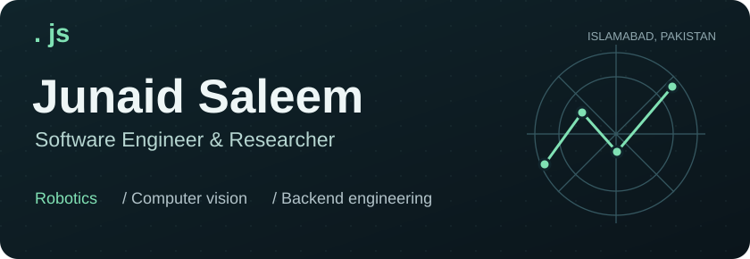
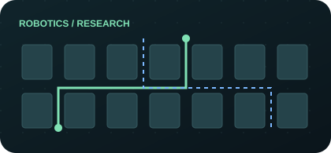
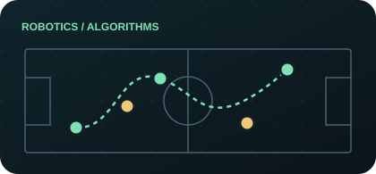
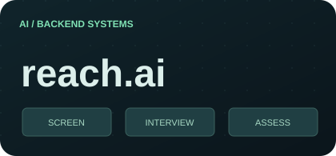
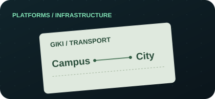
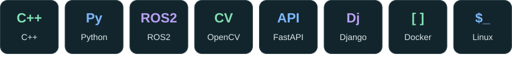
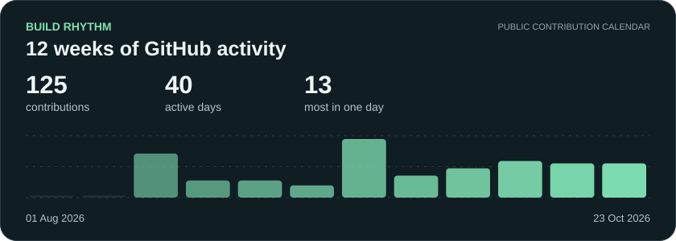
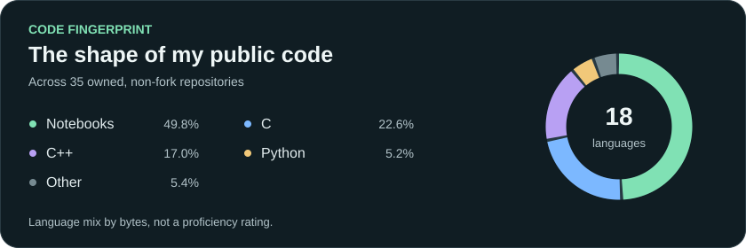

<picture>
  <source media="(max-width: 600px)" srcset="./assets/header-mobile.svg" />
  
</picture>

  
  
  
  

I build software for **robots that move, systems that see, and the backends behind them.** My work spans robot navigation, multi-drone simulation, computer vision, and backend engineering.

**BS Computer Science, GIKI · Class of 2026 · 3.70/4.00 CGPA**

## Where I build

| | Role & focus |
| :--- | :--- |
| **Dune AI** Nov 2026 - Present · Islamabad | **Software Engineer** Robotics and algorithms. |
| **MHTechFusion** Nov 2025 - Present · Remote | **Software Engineer** Computer vision applications, model workflows, and technical leadership. |
| **University of Waterloo** Aug - Oct 2026 · Canada | **Mitacs Globalink Research Intern** Geospatial multi-UAV simulation, path planning, and last-mile delivery research. |
| **Dune AI** Jun - Aug 2025 · Lahore | **Software Engineer Intern** RoboCup SSL simulation, robot navigation, and build/test automation. |

## Selected builds

<table>
<tr>
<td width="50%" valign="top">

<h3>UAV Path Planning Simulator</h3>

A real Toronto map, multiple drones, wind and energy models, uncertainty, and online replanning. Built during my Mitacs research.

<code>Python</code> <code>NetworkX</code> <code>PySide6</code>

<strong>Research project</strong> · Source not public yet

</td>
<td width="50%" valign="top">

<h3>RoboCup SSL Simulator</h3>

Real-time robot soccer simulation. Contributed RRT, RRTX, and A* navigation above 40 Hz, plus a Python Qt controller using ROS2.

<code>C++</code> <code>OpenGL</code> <code>ROS2</code>

<a href="https://github.com/robocup-pk/soccer">Explore the code ↗</a>

</td>
</tr>
<tr>
<td width="50%" valign="top">

<h3>REACH.AI</h3>

Applicant tracking, AI video interviews, and technical assessments in one hiring platform. Includes vision-based proctoring and sandboxed code execution.

<code>FastAPI</code> <code>PostgreSQL</code> <code>AWS</code>

<a href="https://github.com/JunaidSalim/reachai-backend">Explore the backend ↗</a>

</td>
<td width="50%" valign="top">

<h3>GIKI Transport</h3>

Campus reservations, scheduling, and integrated payments. Developed the backend and email notifications, reducing booking to under two minutes.

<code>Django</code> <code>PostgreSQL</code> <code>Graph API</code>

<a href="https://giktransport.giki.edu.pk/">Visit the platform ↗</a>

</td>
</tr>
</table>

## Tools behind the work

<picture>
  <source media="(max-width: 600px)" srcset="./assets/toolkit-mobile.svg" />
  
</picture>

**Robotics → Computer vision → Backend engineering**

<strong>Explore the full toolkit</strong>

- **Robotics & algorithms:** ROS2, Qt/PySide6, OpenGL, NetworkX, A*, Dijkstra, RRT, RRTX.
- **Computer vision & AI:** OpenCV, YOLO, FaceNet, TensorFlow, scikit-learn, LangChain, NumPy, Pandas.
- **Backend & data:** FastAPI, Django, PostgreSQL, Redis, REST APIs, WebSocket, microservices.
- **Languages:** Python, C++, C, SQL, Bash.
- **Infrastructure & tools:** Linux, Git, Docker, AWS, Terraform, GitHub Actions, CMake, Google Test.

## GitHub, visualized

<a href="https://github.com/JunaidSalim?tab=overview">
<picture>
  <source media="(max-width: 600px)" srcset="./assets/activity-mobile.svg" />
  
</picture>
</a>

<picture>
  <source media="(max-width: 600px)" srcset="./assets/code-mix-mobile.svg" />
  
</picture>

Refreshed daily from the contribution calendar visible on my profile and public repository language data. Code mix describes public code, not proficiency.

---

  <strong>Have a project, research idea, or role in mind?</strong> 
  <a href="mailto:junaidsaleem986@gmail.com">Let’s talk</a> · <a href="https://junaidsalim.github.io/">Portfolio</a> · <a href="https://www.upwork.com/freelancers/~01205cd28478cb9efe">Upwork</a> · <a href="https://www.fiverr.com/s/Ld8ZwQY">Fiverr</a>

